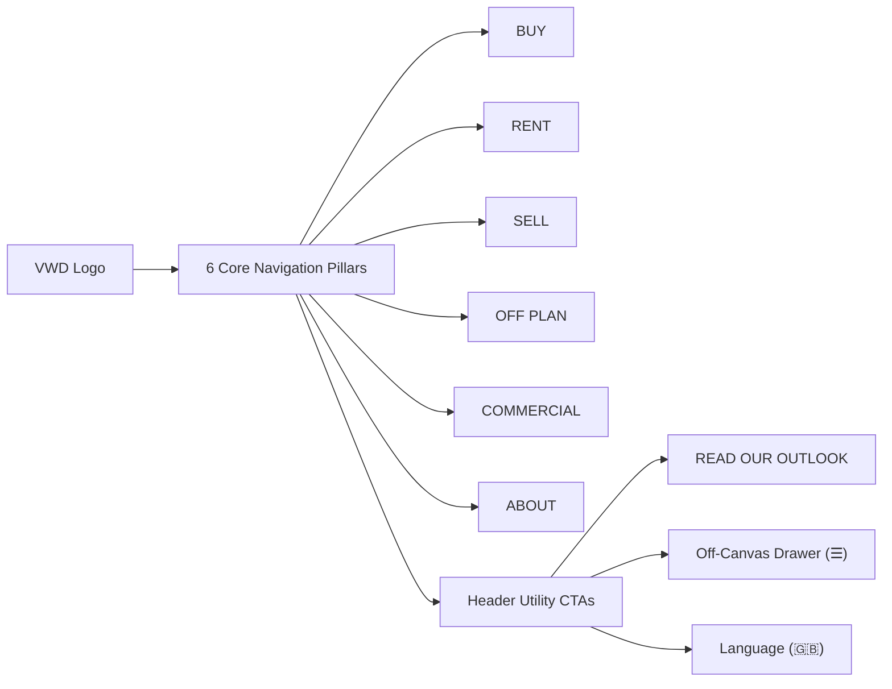
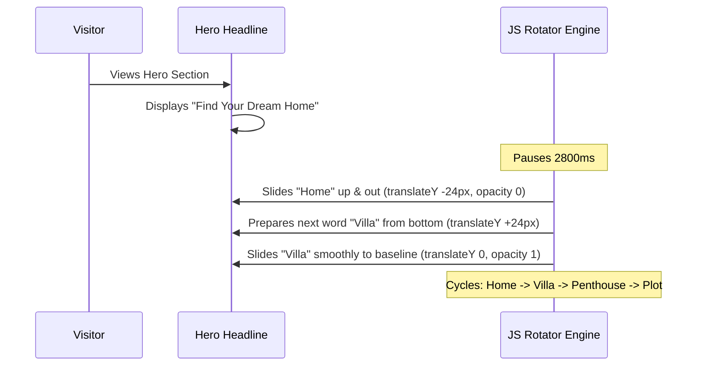

# VWD Real Estate LLC — Architectural Blueprint & Engineering Specification

**Project Repository:** `vwd_real_estate`  
**GitHub Remote:** [manu-gitxen/vwd_real_estate](https://github.com/manu-gitxen/vwd_real_estate.git) (`main` branch)  
**Client:** **VWD REAL ESTATE LLC** (Dubai, United Arab Emirates)  
**Competitor Benchmark:** [White & Co Real Estate](https://whiteandcogroup.com/)  
**Base Foundation:** **HomeID** (Real Estate HTML5 & Bootstrap Foundation in `index.html`)  
**Target Market:** Dubai Luxury Brokerage (Sales, Leasing, Off-Plan Investments, Commercial, Mortgages)  
**Current Status:** Core Foundation, Brand System, 6-Pillar Navigation, 4-Column Sliders & Animated Hero Rotator **Completed & Pushed to Main**  

---

## 1. Executive Summary & Brand Identity

VWD Real Estate LLC is an ultra-luxury Dubai brokerage engineered to compete directly with market leaders like White & Co Real Estate. The digital experience combines enterprise-grade property search with bespoke aesthetics, dynamic financial calculators, and verified community guides.

### 1.1 VWD Luxury Brand Design System

| Element | Specification | Values / Tokens | Implementation |
| :--- | :--- | :--- | :--- |
| **Primary Brand Authority** | Deep Navy Blue | `#00265E` | Navigation headers, dark badges, high-contrast structural accents |
| **Luxury Accent & Metallic** | VWD Luxury Gold | `#CFB165` | Buttons, hover states, active indicators, featured listing badges |
| **Gold Gradient Shimmer** | Metallic Luster | `linear-gradient(135deg, #CFB165 0%, #F5DE98 50%, #CFB165 100%)` | Rotating hero keywords, luxury CTAs |
| **Background Overlays** | Pure & Charcoal Black | `#000000` (opacity 0.40–0.85) / `#1D1D20` | Hero backdrop overlays, footer section, modal masks |
| **Crisp Neutral** | Pure White & Soft Greys | `#FFFFFF`, `#F7F5F0`, `#ABABAB`, `#696969` | Body typography, card surfaces, borders |
| **Brand Assets** | Dual Vector Logos | `images/VWD_logo_transparent.svg` (Dark/Sticky)<br>`images/VWD_logo_white.svg` (Transparent/Dark Hero) | Standardized height `48px`, aspect ratio preserved |

---

## 2. Global Navigation & Header Architecture

The site header is fully aligned with modern luxury brokerage standards, replacing generic demo links with **6 Core Pillars** and White & Co action elements.



### 2.1 Navigation Pillars & Taxonomies

1. **BUY (`properties-for-sale.html`)**:
   - Apartments for Sale
   - Luxury Villas for Sale
   - Penthouses & Sky Collections
   - Townhouses & Duplexes
   - Private Estates & Plots
2. **RENT (`properties-for-rent.html`)**:
   - Annual Residential Leasing
   - Luxury Furnished Apartments
   - High-End Villas & Mansions
   - Holiday Homes & Short-Term Stays
3. **SELL (`list-a-property.html`)**:
   - List Your Property with VWD
   - Free Instant Property Valuation
   - Seller's Advisory & Conveyancing Guide
4. **OFF PLAN (`off-plan.html`)**:
   - Dubai Off-Plan Projects Hub
   - Developer Portfolios (Emaar, Nakheel, DAMAC, Sobha, Meraas, Omniyat)
   - High-ROI Investment Hotspots
   - Flexible Payment Plans Guide
   - Capital Appreciation & Yield Forecasts
5. **COMMERCIAL (`commercial.html`)**:
   - Grade-A Corporate Offices
   - Prime Retail & Showroom Spaces
   - Logistics, Warehouses & Industrial
   - Commercial Land & Full Buildings
6. **ABOUT (`about-us.html`)**:
   - About VWD Real Estate LLC & Mission
   - Meet The Team (Broker Directory)
   - Real Estate Careers & Recruitment
   - Market Reports & Quarterly Outlook
   - Client Reviews & Legal Compliance

### 2.2 Header Action Utilities

- **`READ OUR OUTLOOK` CTA Button**: High-visibility glassmorphism button (`rgba(0, 38, 94, 0.45)` with gold hover `#CFB165`) driving traffic directly to institutional research reports (`market-reports.html`).
- **Off-Canvas Drawer Toggle (`☰`)**: Full-height drawer for quick mobile/tablet access and extended brand directories.
- **Language Indicator (`🇬🇧`)**: English locale indicator prepared for future multi-language expansion (Arabic / Russian).

---

## 3. Hero Section & Animated Headline Engine

The homepage hero features an animated rotating keyword engine designed to showcase VWD's luxury offerings dynamically.



### 3.1 Hero Specifications

- **Eyebrow Subtitle**:  
  `<div class="gel-heading-subtitle vwd-hero-subtitle">LET VWD REAL ESTATE GUIDE YOU TO</div>`  
  *Styling:* Bold 600 weight, `text-transform: uppercase`, `letter-spacing: 3.5px`, crisp white.
- **Main Heading**:  
  `<h1 class="gel-heading-title vwd-hero-title">Find Your Dream <span class="vwd-rotator-wrapper"><span class="vwd-rotator-text">Home</span></span></h1>`  
  *Rotating Categories (Every 2.8s):*
  1. `Home`
  2. `Villa`
  3. `Penthouse`
  4. `Plot`
- **Animation Mechanics**:
  - GPU-accelerated vertical slide-and-fade (`translateY(-24px)` exit, `translateY(24px)` enter).
  - Shimmering metallic gold text fill via `-webkit-background-clip: text` with solid `#CFB165` fallback.
  - Smooth desktop container width transitions (`0.35s cubic-bezier(0.4, 0, 0.2, 1)`) eliminating jumpy layout shifts.
  - **Mobile Stacking:** On viewports `< 768px`, the rotator automatically displays on its own line (`display: block !important; width: 100% !important; text-align: center;`), preventing text clipping.
  - **Performance UX:** Auto-pauses on hover and listens to `document.visibilitychange` to suspend animation loops when the tab is inactive.

---

## 4. Property Card & Carousel Architecture

The HomeID base template included 5 distinct Slick slider carousels that previously stretched listing cards across the full screen due to unparsed double-quoted JSON strings.

### 4.1 Slick Slider Resolution

All `data-slick-options` in `index.html` were re-engineered with valid single-quoted camelCase configuration strings:

```html
data-slick-options='{"slidesToShow": 4, "slidesToScroll": 4, "arrows": true, "dots": true, "infinite": false, "responsive": [{"breakpoint": 1200, "settings": {"slidesToShow": 3, "slidesToScroll": 3}}, {"breakpoint": 992, "settings": {"slidesToShow": 2, "slidesToScroll": 2}}, {"breakpoint": 768, "settings": {"slidesToShow": 1, "slidesToScroll": 1}}]}'
```

- **Desktop (>= 1200px):** 4 Clean columns per slide.
- **Laptop (992px – 1199px):** 3 Columns.
- **Tablet (768px – 991px):** 2 Columns.
- **Mobile (< 768px):** 1 Full-width card with touch swipe.

---

## 5. Reusable Master Templates

The entire 250+ page inventory mapped from the competitor audit is structured into **10 Reusable Master Templates**:

| ID | Master Template | Applied Views | Core Features |
| :--- | :--- | :--- | :--- |
| **T-01** | `HomeTemplate` | `index.html` | Hero search tabs (Buy/Rent/Off-Plan), animated rotator, 4-column carousels, communities showcase, team grid, lead CTA. |
| **T-02** | `ListingGridTemplate` | `properties-for-sale.html`, `properties-for-rent.html`, `commercial.html` | Multi-select filters (Type, Beds, Price, Area), sorting, 3-column card grid, badge overlays, pagination. |
| **T-03** | `PropertyDetailTemplate` | `property-detail.html` (Dynamic `/property/:id`) | High-res image gallery, quick specs (bed/bath/sqft), amenities grid, mortgage calculator embed, sticky WhatsApp contact bar. |
| **T-04** | `ServiceDetailTemplate` | `services-sell.html`, `services-mortgages.html`, `services-property-management.html` | Value propositions, step-by-step process accordion, instant valuation inquiry form, client testimonials. |
| **T-05** | `CommunityDirectoryTemplate` | `communities.html` | 42 Dubai community cards categorized by lifestyle tags (Beachfront, Golf, Urban, Family). |
| **T-06** | `CommunityDetailTemplate` | `community-detail.html` | Community hero, schools, hospitals, commute times, map, and dynamic listings feed in that community. |
| **T-07** | `TeamDirectoryTemplate` | `meet-the-team.html` | Department filter tabs (Sales, Leasing, Commercial, Off-Plan), agent portrait cards with direct Call/WhatsApp/Email triggers. |
| **T-08** | `AgentDetailTemplate` | `agent-detail.html` | Agent bio, languages, RERA license, active listings, direct contact modal. |
| **T-09** | `CalculatorTemplate` | `mortgage-calculator.html`, `rental-yield-calculator.html` | Interactive sliders, real-time formula computation (pure JavaScript), loan amortizations, lead capture. |
| **T-10** | `StandardArticleTemplate` | `market-reports.html`, `blog.html`, `privacy-policy.html`, `terms.html` | Editorial typography, table of contents, downloadable PDF triggers, social share links. |

---

## 6. Financial Algorithms (Dubai Real Estate Standards)

### 6.1 Dubai Mortgage Calculator
Regulated under Central Bank of the UAE mandates (minimum 20% down payment for expat buyers on properties up to AED 5M):

$$\text{Monthly Payment } (M) = P \times \frac{r(1+r)^n}{(1+r)^n - 1}$$

- $P$ = Loan Principal Amount = $\text{Property Price} - \text{Down Payment}$
- $r$ = Monthly Interest Rate = $\frac{\text{Annual Interest Rate}}{12 \times 100}$
- $n$ = Total Monthly Installments = $\text{Loan Term in Years} \times 12$

### 6.2 Dubai Rental Yield Calculator
$$\text{Gross Rental Yield (\%)} = \left(\frac{\text{Annual Rental Income}}{\text{Property Purchase Price}}\right) \times 100$$

$$\text{Net Rental Yield (\%)} = \left(\frac{\text{Annual Rental Income} - \text{Annual Service Charges \& Maintenance}}{\text{Property Purchase Price} + \text{DLD Transfer Fee (4\%)} + \text{Trustee \& Brokerage Fees}}\right) \times 100$$

---

## 7. Security & Version Control Protocol

### 7.1 Secret Protection Policy
- **Mapbox Credentials:** All map components must utilize placeholder tokens (`pk.placeholder_mapbox_token`) in public files to maintain complete compliance with GitHub Push Protection and security audits. Active keys are injected via environment configurations.
- **Repository Cleanliness:** No temporary backup files or credentials committed to source control.

### 7.2 Git Workflows
- **Target Repository:** `https://github.com/manu-gitxen/vwd_real_estate.git`
- **Default Production Branch:** `main`
- All changes must be tested across mobile and desktop breakpoints prior to staging and deployment.

---

## 8. Implementation Roadmap & Progress Tracker

| Milestone | Scope of Work | Status | Verification |
| :--- | :--- | :--- | :--- |
| **Milestone 1** | Project setup, HomeID base template integration, folder asset structuring. | **COMPLETED** | Verified in `index.html` |
| **Milestone 2** | VWD Brand System: Navy (`#00265E`) + Gold (`#CFB165`) palette, dual SVG logos (`VWD_logo_white.svg`, `VWD_logo_transparent.svg`). | **COMPLETED** | Deployed to `main` |
| **Milestone 3** | Card layout fix: Standardized all 5 Slick slider configs to single-quoted camelCase 4-column carousels. | **COMPLETED** | Deployed to `main` |
| **Milestone 4** | 6-Pillar Navigation: BUY, RENT, SELL, OFF PLAN, COMMERCIAL, ABOUT + `READ OUR OUTLOOK` CTA + Drawer Toggle + UK Flag. | **COMPLETED** | Commit `3485b7e` |
| **Milestone 5** | Hero Section: Animated rotating headline cycling 4 luxury categories (Home, Villa, Penthouse, Plot) with metallic gold shimmer and clean single-line alignment. | **COMPLETED** | Verified in `index.html` |
| **Milestone 6** | Secondary Interior Templates: `properties-for-sale.html`, `properties-for-rent.html`, `off-plan.html` with multi-facet filters. | **NEXT** | Pending Phase Kickoff |
| **Milestone 7** | Interactive Financial Tools: Dedicated Dubai Mortgage & Net Rental Yield Calculators. | **QUEUED** | Spec Finalized |
| **Milestone 8** | Dubai Community Guides (42 Locations) & Team Directory (140+ Broker Profiles). | **QUEUED** | Spec Finalized |
| **Milestone 9** | Lead Generation: WhatsApp direct integrations, Valuation Request funnels, and CRM Webhooks. | **QUEUED** | Spec Finalized |
