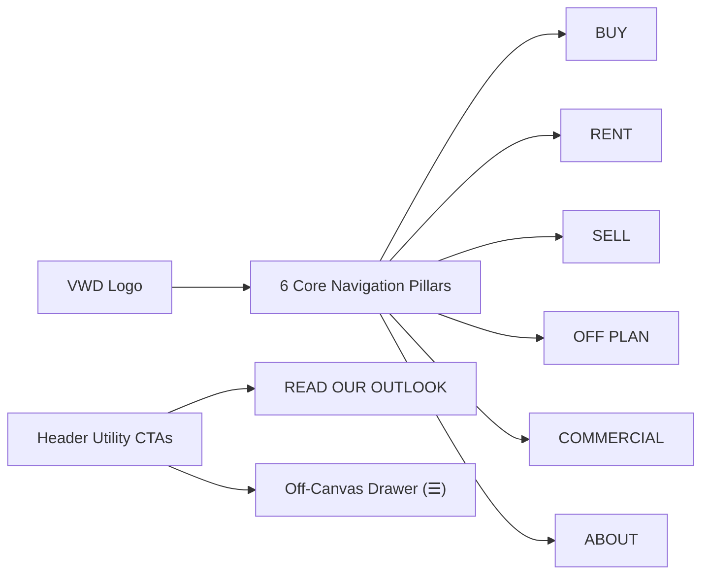
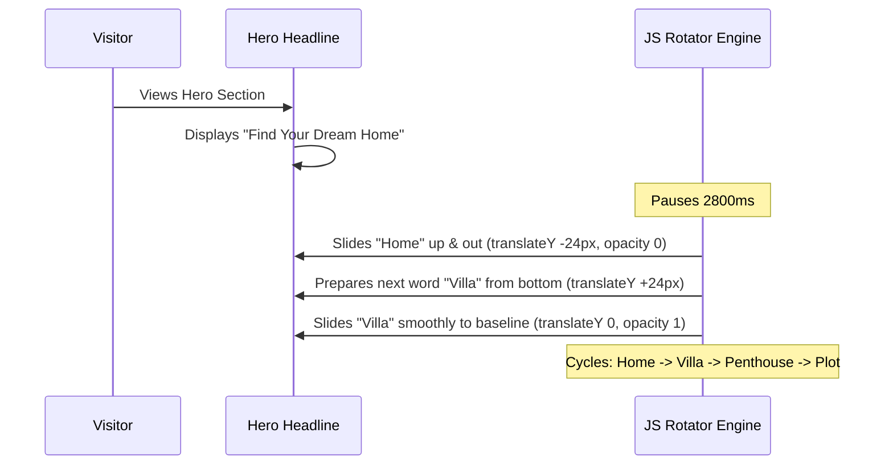

# VWD Real Estate LLC — Architectural Blueprint & Engineering Specification

**Project Repository:** `vwd_real_estate`  
**GitHub Remote:** [manu-gitxen/vwd_real_estate](https://github.com/manu-gitxen/vwd_real_estate.git) (`main` branch)  
**Client:** **VWD REAL ESTATE LLC** (Dubai, United Arab Emirates)  
**Competitor Benchmark:** [White & Co Real Estate](https://whiteandcogroup.com/)  
**Base Foundation:** **HomeID** (Real Estate HTML5, Bootstrap v4.3.1 & WPBakery Foundation in `index.html`)  
**Target Market:** Dubai Luxury Brokerage (Sales, Leasing, Off-Plan Investments, Commercial, Mortgages)  
**Current Status:** Homepage Phase (Steps 1–4, Brand System, 6-Pillar Navigation, 4-Column Sliders, Animated Hero Rotator, RERA/DLD Compliance Footer) **100% Completed & Deployed to Main**  

---

## 1. Executive Summary & Brand Identity

VWD Real Estate LLC is an ultra-luxury Dubai brokerage engineered to compete directly with market leaders like White & Co Real Estate. The digital experience combines enterprise-grade property search with bespoke aesthetics, dynamic financial calculators, verified community guides, and institutional market intelligence.

### 1.1 VWD Luxury Brand Design System

| Element | Specification | Values / Tokens | Implementation |
| :--- | :--- | :--- | :--- |
| **Primary Brand Authority** | Deep Navy Blue | `#00265E` | Navigation headers, dark badges, high-contrast structural accents |
| **Luxury Accent & Metallic** | VWD Luxury Gold | `#CFB165` | Buttons, hover states, active indicators, featured listing badges |
| **Gold Gradient Shimmer** | Metallic Luster | `linear-gradient(135deg, #CFB165 0%, #F5DE98 50%, #CFB165 100%)` | Rotating hero keywords, luxury CTAs |
| **Background Overlays** | Pure & Charcoal Black | `#000000` (opacity 0.40–0.85) / `#1D1D20` | Hero backdrop overlays, footer section, modal masks |
| **Crisp Neutral** | Pure White & Soft Greys | `#FFFFFF`, `#F7F5F0`, `#ABABAB`, `#696969` | Body typography, card surfaces, borders |
| **Brand Assets** | Dual Vector Logos | `images/VWD_logo_transparent.svg` (Dark/Sticky)<br>`images/VWD_logo_white.svg` (Transparent/Dark Hero) | Standardized height `48px`, aspect ratio preserved |

---

## 2. Global Navigation & Header Architecture

The site header is fully aligned with modern luxury brokerage standards, replacing generic demo links with **6 Core Pillars** and White & Co action elements.



### 2.1 Navigation Pillars & Taxonomies

1. **BUY (`properties-for-sale.html`)**:
   - Apartments for Sale
   - Luxury Villas for Sale
   - Penthouses & Sky Collections
   - Townhouses & Duplexes
   - Private Estates & Plots
2. **RENT (`properties-for-rent.html`)**:
   - Annual Residential Leasing
   - Luxury Furnished Apartments
   - High-End Villas & Mansions
   - Holiday Homes & Short-Term Stays
3. **SELL (`list-a-property.html`)**:
   - List Your Property with VWD
   - Free Instant Property Valuation
   - Seller's Advisory & Conveyancing Guide
4. **OFF PLAN (`off-plan.html`)**:
   - Dubai Off-Plan Projects Hub
   - Developer Portfolios (Emaar, Nakheel, DAMAC, Sobha, Meraas, Omniyat, Ellington, Aldar)
   - High-ROI Investment Hotspots
   - Flexible Payment Plans Guide
   - Capital Appreciation & Yield Forecasts
5. **COMMERCIAL (`commercial.html`)**:
   - Grade-A Corporate Offices
   - Prime Retail & Showroom Spaces
   - Logistics, Warehouses & Industrial
   - Commercial Land & Full Buildings
6. **ABOUT (`about-us.html`)**:
   - About VWD Real Estate LLC & Mission
   - Meet The Team (Broker Directory)
   - Real Estate Careers & Recruitment
   - Market Reports & Quarterly Outlook
   - Client Reviews & Legal Compliance

### 2.2 Header Action Utilities

- **`READ OUR OUTLOOK` CTA Button**: High-visibility glassmorphism button (`rgba(0, 38, 94, 0.45)` with gold hover `#CFB165`) driving traffic directly to institutional research reports (`market-reports.html`).
- **Enlarged Off-Canvas Drawer Toggle (`☰`)**: Scaled up to `26px` font icon with luxury hover micro-transition (`transform: scale(1.08)` and `#CFB165` gold accent) on `.vwd-header-drawer-toggle`. Mobile header toggle bars thickened to `2.5px` (`26px × 20px`) for effortless finger taps.
- **Flag Removal**: Demo language selector item (`🇬🇧`) completely eliminated across desktop and mobile headers on all site templates for clean, unencumbered luxury presentation.

### 2.4 Header Presentation Modes (Homepage Floating vs. Interior Solid Header)
- **Homepage (`index.html`)**: Features `.header-float` over the full-screen hero image rotator. In this unscrolled state, the header has a transparent background (`rgba(255, 255, 255, 0)`) and white navigation links (`#ffffff`). When the user scrolls, it transitions into `.sticky` with a solid white background and dark charcoal text (`#333333`).
- **Interior Pages (`properties-for-sale.html`, `properties-for-rent.html`, etc.)**: Interior pages do NOT use `.header-float`. The header sits in natural document flow with a crisp white background (`#ffffff`), subtle border bottom (`#ebebeb`), high-contrast Poppins typography (`#1a1a1a`), active pillar gold highlight (`#CFB165`), deep navy drawer toggle (`#00265E`), and the transparent SVG vector logo (`VWD_logo_transparent.svg`), perfectly separating the header from the page title and breadcrumbs below.

### 2.3 Header Responsive Architecture & Stretched Container Alignment

To guarantee pixel-perfect presentation and symmetric outer margins across all screen resolutions (from ultrawide 2560px down to laptop 992px):
- **Single-Row Flexbox Locking:** `.g5core-header-customize-inner` enforces `flex-wrap: nowrap !important; display: flex !important; align-items: center !important;`, preventing the drawer toggle (`☰`) from dropping underneath the button.
- **Button Text Integrity:** `.vwd-btn-outlook` incorporates `white-space: nowrap !important;`, ensuring the CTA text never breaks onto multiple lines.
- **Laptop Viewport Adaptability (992px – 1250px):** Menu link horizontal padding adjusts to `7px` with `font-size: 12px`, and button padding adjusts to `6px 11px` (`font-size: 11px`), providing smooth clearance for all 6 pillars.
- **Symmetric 95% Stretched Container Rule (992px+):** Legacy theme styles clamped `.container` to a rigid `960px` below 1200px, causing the right edge to collapse to 0 margin at 1119px while the left edge retained outer spacing. This was resolved by extending `.header-layout-stretched .container { max-width: 95% !important; padding: 0 20px !important; }` across all viewports $\ge 992\text{px}$, guaranteeing completely symmetric outer margins on both sides.

---

## 3. Hero Section & Animated Headline Engine

The homepage hero features an animated rotating keyword engine designed to showcase VWD's luxury offerings dynamically.



### 3.1 Hero Specifications

- **Eyebrow Subtitle**:  
  `<div class="gel-heading-subtitle vwd-hero-subtitle">LET VWD REAL ESTATE GUIDE YOU TO</div>`  
  *Styling:* Bold 600 weight, `text-transform: uppercase`, `letter-spacing: 3.5px`, crisp white.
- **Main Heading**:  
  `<h1 class="gel-heading-title vwd-hero-title">Find Your Dream <span class="vwd-rotator-wrapper"><span class="vwd-rotator-text">Home</span></span></h1>`  
  *Rotating Categories (Every 2.8s):*
  1. `Home`
  2. `Villa`
  3. `Penthouse`
  4. `Plot`
- **Animation Mechanics**:
  - GPU-accelerated vertical slide-and-fade (`translateY(-24px)` exit, `translateY(24px)` enter).
  - Shimmering metallic gold text fill via `-webkit-background-clip: text` with solid `#CFB165` fallback.
  - Smooth desktop container width transitions (`0.35s cubic-bezier(0.4, 0, 0.2, 1)`) eliminating jumpy layout shifts.
  - **Tablet & Laptop Scaling (768px – 1199px):** Headings dynamically scale to `44px` with balanced line-height (`1.25`) to prevent awkward line breaks and spacing gaps during rotator transitions.
  - **Mobile Stacking (< 768px):** On viewports `< 768px`, the rotator automatically displays on its own line (`display: block !important; width: 100% !important; text-align: center;`), preventing text clipping.
  - **Performance UX:** Auto-pauses on hover and listens to `document.visibilitychange` to suspend animation loops when the tab is inactive.

---

## 4. Property Card & Carousel Architecture

The HomeID base template includes 5 distinct Slick slider carousels that previously stretched listing cards across the full screen due to unparsed double-quoted JSON strings.

### 4.1 Slick Slider Resolution

All `data-slick-options` in `index.html` were re-engineered with valid single-quoted camelCase configuration strings:

```html
data-slick-options='{"slidesToShow": 4, "slidesToScroll": 4, "arrows": true, "dots": true, "infinite": false, "responsive": [{"breakpoint": 1200, "settings": {"slidesToShow": 3, "slidesToScroll": 3}}, {"breakpoint": 992, "settings": {"slidesToShow": 2, "slidesToScroll": 2}}, {"breakpoint": 768, "settings": {"slidesToShow": 1, "slidesToScroll": 1}}]}'
```

- **Desktop (>= 1200px):** 4 Clean columns per slide.
- **Laptop (992px – 1199px):** 3 Columns.
- **Tablet (768px – 991px):** 2 Columns.
- **Mobile (< 768px):** 1 Full-width card with touch swipe.

---

## 5. Style Architecture & Master Shell Engineering Policy

The site frontend runs on a synchronized, multi-tier layout engine:
1. **Bootstrap v4.3.1:** Core responsive 12-column grid (`container`, `row`, `col-lg-4`, `col-md-6`), forms, and utilities in `css/d18ea250285690b034808cf39b8fc75d.css` (1.29 MB).
2. **WPBakery / Visual Composer:** Section paddings, backgrounds, and layout column wrappers (`vc_row`, `vc_column`).
3. **G5 Core Theme Engine:** Dynamic typography (Poppins), responsive breakpoints, and color themes.
4. **Master Unified Stylesheet (`css/style.css`):** All theme customizations, Gutenberg block tokens, responsive media queries, WPBakery backgrounds (with resolved relative `../images/` URLs), and the VWD Luxury Gold Hero Rotator are consolidated into `css/style.css` (3,030+ lines, ~94 KB).

> [!IMPORTANT]
> **Master Shell Integrity Policy:**  
> The theme's runtime scripts (`frontend.min.js`, `app.min.js`, `js_composer_front.min.js`) directly read DOM style declarations (`document.getElementById('g5core-custom-css')`, `style[data-type="vc_shortcodes-custom-css"]`) and rely on the exact CSS cascade order in `<head>`.  
> To prevent script exceptions and timing race conditions, lightweight DOM placeholder hooks (`<style id="g5core-custom-css"></style>`, `<style id="global-styles-inline-css"></style>`, `<style data-type="vc_shortcodes-custom-css"></style>`) are preserved in `<head>`, and `css/style.css` is linked at the exact point of theme cascade priority.  
> **Engineering Rule:** Every new interior page must be created by cloning the working **Master Shell** (`index.html`), retaining the `<head>`, Global Sticky Header, Global Footer, and script initialization verbatim, while swapping solely the inner content inside `<div id="wrapper_content">...</div>`.

---

## 6. Reusable Master Templates

The entire 250+ page inventory mapped from the competitor audit is structured into **10 Reusable Master Templates**:

| ID | Master Template | Applied Views | Core Features |
| :--- | :--- | :--- | :--- |
| **T-01** | `HomeTemplate` | `index.html` | Hero search tabs (Buy/Rent/Off-Plan), animated rotator, 4-column carousels, communities showcase, value pillars, institutional market reports, compliance footer. |
| **T-02** | `ListingGridTemplate` | `properties-for-sale.html`, `properties-for-rent.html`, `commercial.html` | Multi-facet horizontal filter bar (Type, Community, Beds, Price in AED), sort controls, 3-column Bootstrap card grid, badge overlays, pagination. |
| **T-03** | `PropertyDetailTemplate` | `property-detail.html` (Dynamic `/property/:id`) | High-res image gallery, quick specs (bed/bath/sqft), amenities grid, mortgage calculator embed, sticky WhatsApp contact bar. |
| **T-04** | `ServiceDetailTemplate` | `services-sell.html`, `services-mortgages.html`, `services-property-management.html` | Value propositions, step-by-step process accordion, instant valuation inquiry form, client testimonials. |
| **T-05** | `CommunityDirectoryTemplate` | `communities.html` | 42 Dubai community cards categorized by lifestyle tags (Beachfront, Golf, Urban, Family). |
| **T-06** | `CommunityDetailTemplate` | `community-detail.html` | Community hero, schools, hospitals, commute times, map, and dynamic listings feed in that community. |
| **T-07** | `TeamDirectoryTemplate` | `meet-the-team.html` | Department filter tabs (Sales, Leasing, Commercial, Off-Plan), agent portrait cards with direct Call/WhatsApp/Email triggers. |
| **T-08** | `AgentDetailTemplate` | `agent-detail.html` | Agent bio, languages, RERA license, active listings, direct contact modal. |
| **T-09** | `CalculatorTemplate` | `mortgage-calculator.html`, `rental-yield-calculator.html` | Interactive sliders, real-time formula computation (pure JavaScript), loan amortizations, Dubai upfront fees breakdown, lead capture. |
| **T-10** | `StandardArticleTemplate` | `market-reports.html`, `blog.html`, `privacy-policy.html`, `terms.html` | Editorial typography, table of contents, downloadable PDF triggers, social share links. |

---

## 7. Deep Specification for Phase 2 Interior Pages

### 7.1 `ListingGridTemplate` (`properties-for-sale.html` & `properties-for-rent.html`)
- **Visual Design Integrity & Typography:** 100% matched to the official HomeID template and homepage typography (Poppins 400/500/600/700). Completely eliminated artificial custom inline filter boxes and non-theme wrappers ("AI look").
- **Page Title & Breadcrumbs:** Official HomeID `.g5core-page-title.g5core-page-title-default` and `.g5core-breadcrumbs` hierarchical trail.
- **Horizontal Filter Bar:** Authentic HomeID `.g5ere__search-form.g5ere__sf-layout-layout-01.custom-ere-search-01` form styling:
  - Property Type dropdown (Apartment, Penthouse, Luxury Villa, Townhouse, Duplex, Residential Plot).
  - Dubai Community dropdown (Palm Jumeirah, Downtown Dubai, Dubai Hills Estate, Dubai Marina, Business Bay, Dubai Creek Harbour, Emaar Beachfront).
  - Bedroom selector dropdown (Studio, 1 Bed, 2 Beds, 3 Beds, 4 Beds, 5+ Beds).
  - Min Price & Max Price AED numeric inputs.
  - Reset filters trigger and live client-side reactive filtering.
- **Official HomeID Toolbar:** `.g5ere__toolbar.g5ere__property-toolbar.boxed` with real-time result counter, order selector (*Default Order*, *Price: Low to High*, *Price: High to Low*, *Featured*), and layout switcher (3-column grid vs list).
- **Listing Cards (Skin-02):** Authentic `.g5ere__property-skin-02` cards:
  - Scroll reveal animations powered by HomeID's native engine: `.g5ere__property-item-inner.g5ere__loop-item-inner.g5core__animate-when-almost-visible.g5core__btt`.
  - Badges: Dubai MLS Verified, For Sale / For Rent status, Featured badge.
  - Native HomeID SVG icons (bed, bath, house-plan square footage).
  - Direct WhatsApp agent inquiry buttons (`https://wa.me/971501234567`) on card footers.
- **Pagination:** HomeID-styled numeric pagination (`< 1 2 3 >`).

### 7.2 `OffPlanShowcaseTemplate` (`off-plan.html`)
- **Editorial Hero Banner:** *"Dubai Off-Plan Projects & Investment Launches 2026–2029"* with VIP early-access triggers.
- **Developer Logo Filter Pills:** Quick filters for Dubai Tier-1 master developers (**Emaar**, **Nakheel**, **DAMAC**, **Sobha**, **Meraas**, **Omniyat**, **Ellington**, **Aldar**).
- **Project Specific Attributes:**
  - Handover timeline badges (e.g. `Handover: Q2 2027`, `Q4 2028`).
  - Payment plan highlights in VWD Gold (e.g. `80/20 Payment Plan | 10% Down Payment`).
  - Starting prices (e.g. *"Starting from AED 2,400,000"*).
  - Action CTAs: *"Download Brochure (PDF)"* and *"Book VIP Launch Tour via WhatsApp"*.
- **Investor Advisory Spotlight:** UAE 10-Year Golden Visa eligibility reminder (*properties ≥ AED 2M qualify*) and 0% property tax benefits.

### 7.3 `CalculatorTemplate` (`mortgage-calculator.html`)
- **Regulatory Framework:** UAE Central Bank (CBUAE) lending regulations.
- **Interactive Input Column:**
  - Buyer residency status toggle (*UAE Resident / Expat* min 20% down, *UAE National* min 15%, *Non-Resident* min 35%).
  - Property purchase price slider (AED 1M to AED 50M) with direct numeric input and quick presets (AED 2M, AED 5M, AED 10M, AED 20M).
  - Down payment slider with automatic enforcement of CBUAE minimum legal thresholds.
  - Loan tenure slider (5 to 25 years).
  - Interest rate slider (4.25% to 6.50%).
- **Dynamic Cost Breakdown Output Card:**
  - Monthly payment ($M$) computed via standard amortization formula.
  - Loan Principal vs Total Interest payable.
  - **Comprehensive Dubai Upfront Purchasing Cost Schedule:**
    - DLD Land Department Transfer Fee (4% of property price).
    - DLD Administrative Fee (AED 4,300).
    - Property Registration Trustee Fee (AED 4,200).
    - Real Estate Brokerage Commission (2% + 5% VAT).
    - Bank Mortgage Valuation Fee (~AED 3,000).
    - Mortgage Registration Fee (0.25% of loan amount + AED 290).
    - **Total Upfront Cash Required (Down Payment + Government & Registration Fees).**
- **Lead Capture:** Direct *"Get Pre-Approved with VWD Advisors"* WhatsApp & callback trigger.

### 7.4 `PropertyDetailTemplate` (`property-detail.html`)
- **Authentic HomeID Architecture:** Built directly from the official HomeID Single Property Layout 3 (`C:\Users\manuj\Downloads\vwdproperty_detail_page\index.html`), maintaining 100% theme fidelity (`g5ere__single-property-layout-3`, `g5ere__sph-layout-3`, and `g5ere__spg-wrap-metro-4`) with zero custom "AI" wrapper classes.
- **Dedicated Layout Assets:** Integrated `css/c258d1e8a5b55d5a407daa8ac0fd32f6.css` (Layout 3 stylesheet), `js/mortgage-calculator.min.js`, and `js/comment-reply.min.js`, preserving all 67 official theme scripts and inline SVG icon `<defs>` (`g5ere_garage`, `g5ere_bed`, `g5ere_bath`, `g5ere_house-plan`, `g5ere_real-estate`, `g5ere_interface`).
- **Brand Palette Elimination of Skyblue / Cyan:**
  - Systematically replaced all instances of theme cyan/skyblue (`#0ec6d5`, `#0ca5b1`, `#0b9aa5`, `#3de5f2`, `#25e1f1`, `#eff6f7`, `#bcd9de`) across HTML, `c258d1e8a5b55d5a407daa8ac0fd32f6.css`, and `style.css`.
  - **Overview Icons:** Deep Luxury Navy (`#00265E`) with warm champagne background (`rgba(207, 177, 101, 0.1)`) and gold border (`rgba(207, 177, 101, 0.4)`). Transitions to Gold (`#CFB165`) on card hover.
  - **Action Buttons ("Open on Google Maps", "Send message"):** Solid Luxury Navy (`#00265E`) with white text; transitions smoothly to Gold (`#CFB165`) with Navy text on hover.
  - **Form Sanitization:** Hid broken demo localhost Google reCAPTCHA widget (`display: none !important;`) to eliminate red error banners.
- **Full Dubai Market Localization:**
  - **Address Block:** Country (*United Arab Emirates*), Province/State (*Dubai*), City/Town (*Dubai*), Neighborhood (*Palm Jumeirah*).
  - **Overview & Details Specs:** 5 Bedrooms, 6 Bathrooms, 4 Covered Garages, 8,500 Sq.Ft Built-Up Area, 11,200 Sq.Ft Beachfront Plot, Year Built 2024.
  - **Currency & Pricing:** All monetary values converted to AED (`AED 34,500,000`, `AED 4,058 / sq.ft`).
  - **Embedded Mortgage Calculator:** Currency updated to `AED` with pre-filled default values (`AED 34,500,000` price, `AED 6,900,000` 20% down payment).
- **Solid Interior Header & Footer:** Verbatim VWD 6-pillar header (solid white background, navy drawer toggle, gold active states, and `READ OUR OUTLOOK` CTA) plus standard RERA/DED compliance footer.
- **5-Photo Metro Mosaic Gallery (`g5ere__spg-metro-4`):**
  - Hero landscape photo (66% left) with fullscreen overlay trigger.
  - 4 squared mosaic thumbnails (33% right) with native pill tab controls (Photos, Location Map, 360° Virtual Tour).
  - Integrated with Magnific Popup lightbox for high-resolution responsive viewing with zoom animations and multi-photo slide progression.
- **Main Information Stream (Left 67%):**
  - **Overview Specs Grid:** Bedrooms (en-suite), Bathrooms, Built-up Area (Sq.Ft), Plot Size, Covered Parking, Completion Year, DLD Permit Number, and Freehold Status.
  - **Editorial Description:** Institutional luxury property narrative highlighting architecture, joinery, and Gulf views.
  - **Luxury Amenities Checklist:** 16 verified Dubai amenities (private beach, infinity pool, Lutron automation, Schindler elevator, dual show/prep kitchens, staff quarters, private cinema, sauna).
  - **Interactive Floor Plans Accordion:** Multi-level collapsible architectural floor plans (Ground Floor, First Floor, Rooftop Sunset Deck).
  - **4K Drone Video Showcase:** 4K video tour thumbnail with cinematic play modal trigger.
  - **Clean Information Architecture:** Pruned extraneous demo components (removed mock Attachments download card, Yelp API rate-limited Nearby Places block, and legacy Rating & Reviews widget).
  - **Similar Properties Showcase:** Handpicked luxury residences carousel following the floor plans and media streams.
- **Sticky Broker Sidebar (`sidebar-sticky` Right 33%):**
  - Senior Director profile card (Alexander Vance, RERA BRN: 48921, ORN: 30124).
  - Direct triggers: WhatsApp Broker Directly (`wa.me` pre-filled message), Schedule Private Viewing modal trigger, and direct call trigger.
  - Quick instant inquiry lead form.
  - Embedded CBUAE Mortgage Calculator and Upfront Government & Brokerage Fees Schedule (DLD 4%, Trustee Fee, Admin, 2% Brokerage + VAT).
- **Dynamic URL Parameter Hydration Engine:**
  - Client-side data dictionary matching all 12 properties for sale and 12 properties for rent.
  - Passing `?id=102`, `?id=103`, `?id=201`, etc. dynamically updates page title, breadcrumb trail, pricing, specs, images, description, and WhatsApp links.
  - Defaults to the flagship Palm Jumeirah Signature Beachfront Villa (AED 34,500,000) when visited directly.
- **Mobile Fixed Bottom Bar:** Fixed-bottom quick action bar (`WhatsApp` + `Book Viewing`) on viewports `< 992px`.

### 7.5 Card Action Button Alignment & Spacing Policy
- **Circular Action Button Geometry (`.g5ere__lpa-rounded a.vwd-wa-btn`):**
  - Enforced `display: inline-flex !important; align-items: center !important; justify-content: center !important;` to lock the WhatsApp icon to the exact mathematical center of the 40px circular boundary.
  - Set `line-height: 1 !important; padding: 0 !important;` to prevent baseline shifting.
  - Removed asymmetrical inline `margin-right: 10px;` on the WhatsApp button to establish uniform 10px gaps between all three circular triggers: `[WhatsApp] 10px [Favorite] 10px [Compare]`.
  - Configured high-contrast hover state (`background-color: #25D366; color: #ffffff`).

### 7.6 `OffPlanDetailTemplate` (`off-plan-detail.html`)
- **Authentic HomeID Architecture:** Built directly from the official HomeID Single Property Layout 2 (`g5ere__single-property-layout-2`) with Metro-1 5-photo collage gallery (`g5ere__spg-metro-1`), matching user-provided layout in `C:\Users\manuj\Downloads\offplanvwd`.
- **Hero Showcase & Metro Gallery:**
  - Featured flagship rendering (Emaar Creek Waters, Dubai Creek Harbour).
  - 5-photo responsive collage with hover effects, native media badges, and full-screen lightbox trigger.
- **Milestone Payment Plan:** Standardized 70/30 Dubai off-plan investor payment structure:
  - 10% Down Payment (On Booking).
  - 60% During Construction (Milestones 1–6).
  - 30% Upon Handover (100% Completion).
- **Pruned Unwanted Demo Blocks:** Pruned extraneous demo widgets to eliminate console errors and maintain institutional quality:
  - Removed mock Attachments download card.
  - Removed Yelp API-dependent Nearby Places block (preventing 404/API quota errors).
  - Removed legacy Rating & Reviews widget with generic demo comments.
- **Solid Interior Header:** Non-floating solid white header (`.g5core-site-header:not(.header-float)`) with deep navy branding, enlarged 26px drawer toggle, and clean navigation flow.

### 7.7 Universal 4-Column Footer Architecture (All 7 Site Templates)
- **CSS Grid Centered Alignment:** Replaced the legacy asymmetrical footer with a clean, symmetric 4-column CSS grid (`.vwd-footer-grid`) centered inside `.vwd-footer-container` (`max-width: 1320px`), completely eliminating right-side white space gaps across all screen widths:
  - **Column 1 (Corporate Identity):** Official VWD Real Estate LLC SVG logo, Dubai Land Department (DLD) licensing info, RERA ORN: 30124, DED License: 1124589, and luxury gold social icons.
  - **Column 2 (Dubai Portfolios):** Quick links to Properties for Sale, Rental Residences, Off-Plan Launches, Commercial Spaces, and Private Penthouses.
  - **Column 3 (Advisory & Services):** Private Office Advisory, UAE 10-Year Golden Visa Consultation, Mortgage & Conveyancing, Market Research Reports, and Instant Property Valuation.
  - **Column 4 (Headquarters & Contact):** Suite 1402, Control Tower, Motor City, Dubai, UAE; direct phone (+971 4 876 5432), email (`contact@vwdrealestate.com`), WhatsApp trigger, and RERA certified brokerage badge.
- **Uniform Legal Bar:** Bottom row with symmetrical privacy policy, terms of service, and sitemap links paired with official copyright notice (`© 2026 VWD Real Estate LLC. All Rights Reserved.`).
- **Synchronized Deployment:** Implemented uniformly across all 7 production templates: `index.html`, `off-plan.html`, `off-plan-detail.html`, `off-plan-properties.html`, `properties-for-sale.html`, `properties-for-rent.html`, and `property-detail.html`.

### 7.8 Typography & Theme Integrity Policy
- **Strict Website Default Font Enforcement:**
  - All site templates must strictly use the website's default font family (`Poppins, sans-serif` via `font-family: inherit !important;`).
  - Strict ban on unrequested external Google Fonts (e.g. Playfair Display, Plus Jakarta Sans) to preserve brand cohesion, fast page load times, and authentic theme typography.
- **Institutional Market Intelligence Section (`index.html`):**
  - Section background retained in deep VWD brand navy (`#00265E`).
  - Typography styled using native theme inheritance with balanced scales (`34px` title, `18px` card titles, `14px` body).
  - Category badges use crisp rectangular luxury tags (`border-radius: 2px`) rather than rounded 20px AI pill capsules.

---

## 8. Financial Algorithms (Dubai Real Estate Standards)

### 8.1 Dubai Mortgage Payment Formula

$$\text{Monthly Payment } (M) = P \times \frac{r(1+r)^n}{(1+r)^n - 1}$$

- $P$ = Loan Principal Amount = $\text{Property Price} - \text{Down Payment}$
- $r$ = Monthly Interest Rate = $\frac{\text{Annual Interest Rate}}{12 \times 100}$
- $n$ = Total Monthly Installments = $\text{Loan Term in Years} \times 12$

### 8.2 Dubai Rental Yield Formula

$$\text{Gross Rental Yield (\%)} = \left(\frac{\text{Annual Rental Income}}{\text{Property Purchase Price}}\right) \times 100$$

$$\text{Net Rental Yield (\%)} = \left(\frac{\text{Annual Rental Income} - \text{Annual Service Charges \& Maintenance}}{\text{Property Purchase Price} + \text{DLD Transfer Fee (4\%)} + \text{Trustee \& Brokerage Fees}}\right) \times 100$$

---

## 9. Security & Version Control Protocol

### 9.1 Secret Protection Policy
- **Mapbox Credentials:** All map components must utilize placeholder tokens (`pk.placeholder_mapbox_token`) in public files to maintain complete compliance with GitHub Push Protection and security audits. Active keys are injected via environment configurations.
- **Repository Cleanliness:** No temporary backup files or credentials committed to source control.

### 9.2 Git Workflows
- **Target Repository:** `https://github.com/manu-gitxen/vwd_real_estate.git`
- **Default Production Branch:** `main`
- All changes must be tested across mobile and desktop breakpoints prior to staging and deployment.

---

## 10. Implementation Roadmap & Progress Tracker

| Milestone | Scope of Work | Status | Verification |
| :--- | :--- | :--- | :--- |
| **Milestone 1** | Project setup, HomeID base template integration, folder asset structuring. | **COMPLETED** | Verified in `index.html` |
| **Milestone 2** | VWD Brand System: Navy (`#00265E`) + Gold (`#CFB165`) palette, dual SVG logos (`VWD_logo_white.svg`, `VWD_logo_transparent.svg`). | **COMPLETED** | Deployed to `main` |
| **Milestone 3** | Card layout fix: Standardized all 5 Slick slider configs to single-quoted camelCase 4-column carousels. | **COMPLETED** | Deployed to `main` |
| **Milestone 4** | 6-Pillar Navigation: BUY, RENT, SELL, OFF PLAN, COMMERCIAL, ABOUT + `READ OUR OUTLOOK` CTA + Drawer Toggle + UK Flag. | **COMPLETED** | Commit `3485b7e` |
| **Milestone 5.0** | Hero Section: Animated rotating headline cycling 4 luxury categories (Home, Villa, Penthouse, Plot) with metallic gold shimmer and clean single-line alignment. | **COMPLETED** | Commit `c5819e5` |
| **Milestone 5.1** | Step 1 — Featured Properties in AED: 20 luxury Dubai properties (10 Sale, 10 Rent) across Palm Jumeirah, Downtown, Dubai Hills, Emaar Beachfront, plus localized hero search dropdowns. | **COMPLETED** | Commit `c822ed1` |
| **Milestone 5.2** | Step 2 — Dubai Communities Showcase: 8-destination slider (Palm Jumeirah, Downtown Dubai, Dubai Hills, Dubai Marina, Business Bay, Dubai Creek Harbour, Jumeirah Golf Estates, Emaar Beachfront). | **COMPLETED** | Commit `482f622` |
| **Milestone 5.3** | Step 3 — VWD Advisory Pillars & Market Intelligence Spotlight: 3 concise corporate advisory pillars + dedicated quarterly Dubai Real Estate Outlook feature section. | **COMPLETED** | Commits `434dfa6`, `b001965` |
| **Milestone 5.4** | Step 4 — Footer Localization & Compliance: Dubai HQ (Control Tower, Motor City), RERA ORN: 30124 & DED licenses, structured Properties & Advisory menus, Market Intelligence newsletter, 2026 legal copyright. | **COMPLETED** | Commit `d9ed402` |
| **Milestone 5.5** | Master Stylesheet & Responsive Architecture: Consolidated 3,000+ lines into `css/style.css` with DOM placeholder hooks, single-row header actions, 95% stretched container rule across 992px+, and tablet/laptop hero scaling. | **COMPLETED** | Verified in `index.html` & `css/style.css` |
| **Milestone 6.1** | Secondary Interior Templates (Sales & Rentals): Implemented authentic HomeID `properties-for-sale.html` and `properties-for-rent.html` matching reference typography (Poppins), official skin-02 cards, native page titles & breadcrumbs, boxed toolbar, scroll reveal animations (`.g5core__btt`), and zero AI inline wrappers. | **COMPLETED** | Verified & Tested in both files |
| **Milestone 6.2** | Property Detail Template (`property-detail.html`): Built directly from official HomeID Single Property Layout 3 (`g5ere__single-property-layout-3`), integrated `c258d1e8a5b55d5a407daa8ac0fd32f6.css` & scripts, eliminated all skyblue/cyan theme accents in favor of VWD Navy (`#00265E`) and Gold (`#CFB165`), localized address/specs to Dubai UAE, centered card WhatsApp triggers, and hid demo reCAPTCHA. | **COMPLETED** | Verified in `property-detail.html` & `css/style.css` |
| **Milestone 6.3** | Secondary Interior Templates (Off-Plan Investment System): Architected White & Co-matching 2-tier ecosystem: (1) **Off-Plan Investment Hub (`off-plan.html`)** featuring cinematic hero with user-uploaded sunset terrace image, 3 investment budget tiers (Entry < AED 2M, Mid-Tier AED 2M-5M, Luxury AED 5M+), 6-card "Explore by Area" destination grid with interactive hover zooms, 8-card "Explore by Developer" master partner directory, VWD by The Numbers stats, and DLD Escrow/Golden Visa investor intelligence; (2) **Off-Plan Projects Directory (`off-plan-properties.html`)** featuring multi-facet filter bar (developer, location, handover, max price), live reactive card filtering, view toggle, and URL query support (`?tier=entry`, `?location=`, `?developer=`). | **COMPLETED** | Verified across `off-plan.html`, `off-plan-properties.html`, and `css/style.css` |
| **Milestone 6.4** | Off-Plan Detail Template (`off-plan-detail.html`): Built directly from official HomeID Single Property Layout 2 (`g5ere__single-property-layout-2`) with Metro-1 5-photo collage gallery (`g5ere__spg-metro-1`), Emaar Creek Waters project showcase, 70/30 milestone payment plan, non-floating solid header, and pruned Yelp/review demo blocks. | **COMPLETED** | Verified in `off-plan-detail.html` |
| **Milestone 6.5** | Universal Footer & Global Header Refinement: Rebuilt footer into clean 4-column symmetric grid (`.vwd-footer-grid`) centered in `1320px` container across all 7 pages; removed UK flag language toggle (`🇬🇧`); enlarged hamburger drawer toggle to `26px` with luxury hover micro-interactions. | **COMPLETED** | Verified across all 7 HTML files & `css/style.css` |
| **Milestone 6.6** | Typography & Theme Integrity Policy: Enforced website default font (`Poppins, sans-serif` via `inherit`) across all custom sections, preserved VWD navy background (`#00265E`) on Market Intelligence section, and eliminated unrequested foreign font imports. | **COMPLETED** | Verified in `index.html` & `css/style.css` |
| **Milestone 7** | Interactive Financial Tools: Dedicated Dubai Mortgage & Net Rental Yield Calculators. | **QUEUED** | Spec Finalized |
| **Milestone 8** | Dubai Community Guides (42 Locations) & Team Directory (140+ Broker Profiles). | **QUEUED** | Spec Finalized |
| **Milestone 9** | Lead Generation: WhatsApp direct integrations, Valuation Request funnels, and CRM Webhooks. | **QUEUED** | Spec Finalized |
